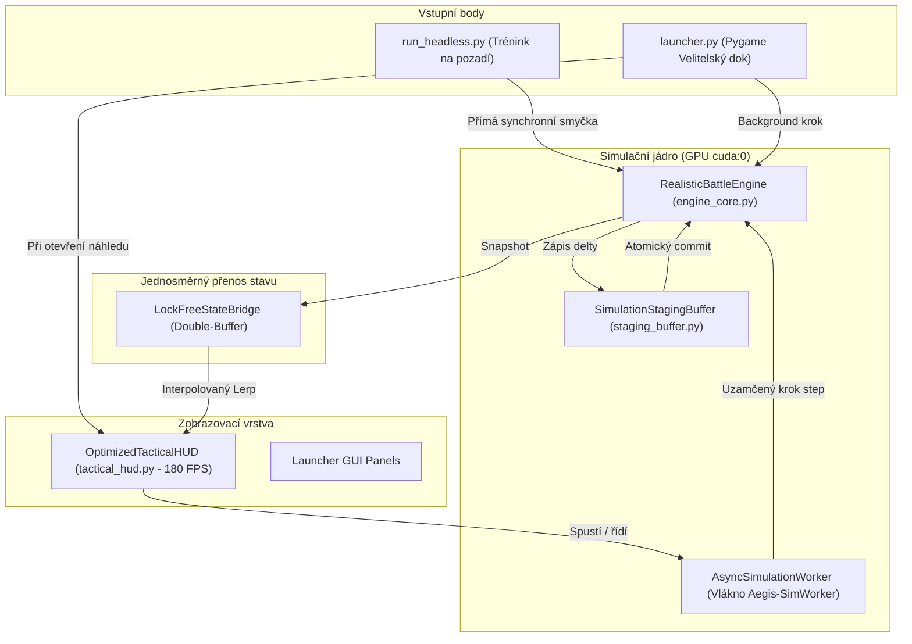

# ARCHITEKTONICKÝ AUDIT A MAPA SYSTÉMU CYBER-TACTICS
**Datum:** 12. listopadu 2026  
**Autor:** Senior Softwarový Architekt & PyTorch/CUDA Specialista  
**Stav:** Analytická fáze (Čistě read-only, nulové změny produkčního kódu)

---

## 1. Souhrn kódové báze (AST Audit)

Statická analýza pomocí Python AST parseru prošla všech **61 Python souborů** v repozitáři:
* **Celkový objem:** **14 284 řádků kódu (LOC)**
  * **Aktivní produkční jádro (`src/`, `launcher.py`, `run_headless.py`):** 7 101 LOC (21 souborů)
  * **Historický a prototypový archiv (`archive/`):** 7 003 LOC (39 souborů)
  * **Testovací sada (`tests/`):** 180 LOC (1 soubor)
* **Kruhové závislosti (Circular Imports):** V aktivním jádru `src/` byly všechny kruhy v dřívější fázi úspěšně eliminovány (graf závislostí tvoří čisté DAG – Directed Acyclic Graph).

### Tabulka klíčových souborů aktivního jádra

| Soubor | LOC | Třídy | Funkce / Metody | Skutečná zodpovědnost & Role | Typ komponenty |
| :--- | :---: | :---: | :---: | :--- | :--- |
| **`src/engine_core.py`** | **1 513** | 1 | 19 | Centrální GPU fyzika, Zero-Script MLP integrace, balistika, zóny, správa částic, evoluční ROI | **God Object (Jádro)** |
| **`launcher.py`** | **1 133** | 2 | 26 | Pygame okno, launcher dok, správa procesů, export CSV, embedded HUD spouštění | **God Object (Launcher)** |
| **`src/tactical_hud.py`** | **1 033** | 1 | 20 | Taktické HUD rozhraní, 180 FPS renderer, dokovací panely, kamera, inspekce agenta | **God Object (GUI)** |
| **`src/telemetry_lab.py`** | **727** | 1 | 7 | Analýza genofondu, Pygame grafy distribuce vah, PCA/t-SNE projekce mozků | UI / Analýza |
| **`src/ai_brains.py`** | **434** | 2 | 17 | Třídně izolovaný genofond, 2-vrstvý batched MLP (14->64->64->7), křížení a mutace | AI / PyTorch |
| **`src/battlefield_renderer.py`** | **351** | 0 | 18 | Funkcionální Pygame kreslení vojáků, laserů, krytí, kouřových clon, radarů | Render |
| **`src/telemetry_logger.py`** | **312** | 1 | 12 | Parquet & CSV ukládání prostorových událostí, snapshoty modelů `.pt` | Telemetrie / IO |
| **`src/analyze_telemetry.py`** | **280** | 0 | 3 | Offline Matplotlib generování grafů fitness a prostorových heatmap | Offline Analýza |
| **`src/scenarios.py`** | **257** | 1 | 4 | Definice 3 map (Domination, Citadel, Chasm), překážky, Flow-field | Data / Mapy |
| **`src/engine/spatial_system.py`** | **195** | 1 | 4 | Detekce kolizí s AABB stěnami a pilíři, Ray-AABB viditelnost (Line of Sight) | Fyzika / GPU |
| **`src/engine/ballistics_system.py`** | **185** | 1 | 2 | Úhlová redukce pancíře (dot product), penetrace, kinetický ragdoll | Balistika / GPU |
| **`src/engine/async_runner.py`** | **151** | 1 | 9 | Asynchronní worker vlákno s časovým akumulátorem pro fixní 60 TPS krok | Concurrency / Threading |
| **`src/engine/objectives_system.py`** | **150** | 1 | 4 | Zničitelné brány, vyhodnocení dominance v uzlech a strategických bodech | Pravidla / GPU |
| **`src/engine/combat_system.py`** | **137** | 1 | 2 | Třídní schopnosti (kouř, štít, sniper focus, medic prioritní léčení) | Boj / GPU |
| **`src/engine/state_bridge.py`** | **133** | 2 | 3 | Lock-Free Double Buffer se sférickou Hermite-Lerp interpolací pro 180 FPS | Concurrency / Data |
| **`src/engine/staging_buffer.py`** | **36** | 1 | 2 | Zero-Trust Staging tenzory pro atomický commit změn stavu | Paměť / GPU |

---

## 2. Tok dat a hlavní cyklus (Data Flow & Main Loops)

Systém v současnosti obsahuje **dvě alternativní cesty spuštění**:



### Hlavní simulační smyčka (`_worker_loop`):
1. **Příjem příkazů:** Worker zkontroluje `command_queue` z GUI (změna scénáře, doktríny, evoluce).
2. **Akumulátor času:** Měří reálný čas `perf_counter` a provádí diskrétní kroky se striktně fixním $\Delta t = 1/60\,\text{s}$.
3. **Výpočet fyziky a AI (`engine.step`):**
   * Percepce: Vzdálenosti `torch.cdist`, Line of Sight (Ray-AABB), senzory formace.
   * Mozky: Batched MLP forward pass (14 vstupů $\to$ 7 akcí).
   * Pohyb & Kolize: Integrace hybnosti, odrazy od stěn přes flow-field.
   * Balistika & Schopnosti: Zápis zásahů do `SimulationStagingBuffer`.
   * Atomický commit: Zápis poškození, úhlového pancíře a vyhodnocení eliminací.
4. **Publikace stavu:** Stažení snapshotu do `LockFreeStateBridge`.

---

## 3. Výkonnostní audit a synchronizační bariéry (GPU <-> CPU Bottlenecks)

Při AST auditu jsme detekovali **146 volání způsobujících Pipeline Stall** v aktivním kódu:

### 1. Masivní PCIe přenos v `get_battle_state_snapshot()` (31× `.cpu()`, 30× `.numpy()`)
* **Problém:** Při každém kroku simulace (až 60–120× za sekundu) se z GPU stahuje **31 samostatných tenzorů** na CPU (`pos`, `heading`, `hp`, `classes`, `suppression`, `tracers`, `nodes`, atd.).
* **Důsledek:** Každé jednotlivé volání `.cpu().numpy()` nutí procesor čekat na dokončení všech předchozích CUDA operací. Sběrnice PCIe je bombardována drobnými pakety místo jednoho spojitého přenosu.
* **Výsledek v reálu:** To je pravá příčina oněch **91.5 ms záseků**, které uživatelka viděla na obrazovce!

### 2. Dynamická alokace tenzorů uvnitř hot-loopu v `_step_internal()`
* V každém simulačním kroku se za běhu vytváří:
  * `torch.tensor([8, 9, 22, 5], device=...)` (cooldown zbraní)
  * `torch.tensor([0.82, 0.80, 0.90, 0.78], device=...)` (přesnost tříd)
* **Důsledek:** Zbytečná alokace CUDA paměti 60× za sekundu. Tyto tenzory mají být prealokované konstanty v `__init__`.

### 3. Zpětný transfer CPU -> GPU při vyhodnocení zón (řádky 1133–1183)
* `cnts = torch.bincount(pres_t, minlength=4).cpu().numpy()`
* Dominance se vyhodnocuje v Pythonu na CPU a následně se pole vrací zpět na GPU:
  `self.nodes_gpu.copy_(torch.from_numpy(nodes_cpu).to(self.device))`
* **Důsledek:** Zbytečný ping-pong GPU $\to$ CPU $\to$ GPU uprostřed fyzikálního kroku.

---

## 4. Seznam 5 nejkritičtějších architektonických problémů

1. **God Object `src/engine_core.py` (1 513 řádků):**
   * Míchá dohromady tensorovou fyziku, nákup jednotek generály, vyhodnocení pravidel bran, textové logování událostí, generování vizuálních trosek (`particles`) a stahování dat pro UI.
2. **Neefektivní předávání stavu do UI:**
   * Místo kompaktního strukturálního bufferu (např. jednoho float32 tenzoru pro všechny entity) se posílá obří Python slovník s 30 samostatnými NumPy poli.
3. **Duplicitní zodpovědnost za simulaci (Launcher vs HUD):**
   * `launcher.py` má svou vlastní simulační smyčku na pozadí, zatímco `tactical_hud.py` má své worker vlákno. Tyto dvě smyčky se historicky praly o stejnou instanci enginu.
4. **Zátěž Python GIL při Pygame vykreslování:**
   * Pygame render běží ve stejném Python procesu jako worker vlákno. Složité vykreslování 2D geometrie blokuje GIL a zpožďuje simulační vlákno.
5. **Směs herních dat a konfigurace v kódu:**
   * Ceny jednotek, statistiky zbraní, konstanty mapy a barvy frakcí jsou roztroušeny na 4 různých místech (`config.py`, `engine_core.py`, `ai_brains.py`, `tactical_hud.py`).

---

## 5. Návrh cílové modulární architektury

Navrhujeme rozdělit systém do 4 striktně oddělených vrstev:

```
test/
├── config/                  # ČISTÁ DATA A KONFIGURACE (nulové závislosti na Torch/Pygame)
│   ├── balance.py           # Statistiky tříd, zbraně, perky, doktríny
│   ├── display.py           # Barvy, fonty, rozlišení, UI rozměry
│   └── scenarios.py         # Geometrie map, zóny, překážky
│
├── core/                    # PYTORCH GPU VÝPOČETNÍ JÁDRO (čistá matematika, nulový import Pygame)
│   ├── sim_state.py         # Kompaktní tenzorový stav jednotek (SoA - Structure of Tensors)
│   ├── neural_swarm.py      # Batched MLP mozky a evoluční křížení
│   ├── physics_engine.py    # Odpuzování od stěn, pohyb, kolize
│   └── combat_engine.py     # Balistika, penetrace, poškození, status efekty
│
├── runtime/                 # BĚHOVÉ PROSTŘEDÍ A INTERNET/STATE BRIDGE
│   ├── simulation_host.py   # Jediný autoritativní orchestrátor simulace (vlastní Worker)
│   ├── pinned_bridge.py     # Pinned Memory přenos (1 transfer na snímek z GPU do CPU)
│   └── telemetry_writer.py  # Asynchronní ukládání do Parquet / souborů
│
└── ui/                      # TUPÉ PLÁTNO (pouze Pygame, nulový přístup k GPU tensorům)
    ├── engine_view.py       # Plátno bojiště (čte pouze CPU snapshot z Bridge)
    ├── hud_overlay.py       # Taktické panely, tlačítka, výběr jednotky
    └── commander_dock.py    # Velitelský dok Launcheru
```

---

## 6. Bezpečný etapový plán realizace (Fáze 1 až 4)

Každý krok je navržen tak, aby **vždy po jeho dokončení prošla celá testovací sada** `tests/test_suite.py` a aplikace zůstala plně funkční.

### Fáze 1: Vyčištění GPU<->CPU úzkých hrdel v existujícím jádru
* Odstranit dynamické `torch.tensor(...)` uvnitř `step()` (přesunout konstanty cooldownů a přesností do `__init__`).
* Přepsat dominance v uzlech (řádky 1133–1183) na čisté GPU operace bez převodu do NumPy a zpět.
* Zredukovat `get_battle_state_snapshot()`: zabalit pozice, úhly a stavy do jednoho nebo dvou sdružených GPU tensorů a stáhnout je v jediné PCIe transakci.

### Fáze 2: Unifikace orchestrátoru simulace (`SimulationHost`)
* Zrušit konkurenční `step_simulation_background` v Launcheru.
* Vytvořit jedinou komponentu `SimulationHost`, která spravuje životní cyklus workeru.
* Launcher i HUD se na tento host pouze napojují jako pasivní klienti.

### Fáze 3: Vyčlenění herních konstant do `config/`
* Sjednotit všechny rozptýlené konstanty (třídy, ceny, barvy, doktríny) do jednotného modulu `config/`.
* Aktualizovat importy v jádře i v UI.

### Fáze 4: Modularizace God Objectu `engine_core.py`
* Rozdělit metody `engine_core.py` do dílčích subsystémů:
  * `core/combat_engine.py` (balistika a poškození)
  * `core/objectives_engine.py` (obsazování uzlů a brány)
  * `core/evolution_engine.py` (vyhodnocení epochy a odměny generálů)
* `engine_core.py` zůstane jako tenký fasádový koordinátor (Facade Pattern) zaručující zpětnou kompatibilitu.
