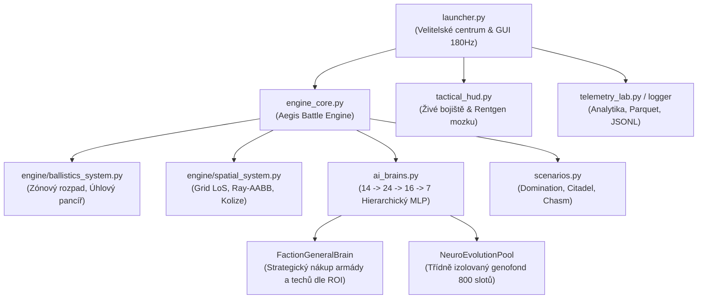

# CYBER-TACTICS // Kompletní systémová a technická dokumentace

> **Verze projektu:** 2.0 (Aegis Decoupled Engine)  
> **Platforma:** Windows 10/11 x64, Python 3.12, PyTorch CUDA, Pygame-CE (SDL 2.32)  
> **Architektura:** Asynchronní / Vektorová deterministická simulace s hierarchickou neuroevolucí a rentgenovým HUDem

---

## 1. Přehled architektury systému

Projekt **Cyber-Tactics** je realtime simulátor taktického boje armád řízených autonomní umělou inteligencí. Využívá paralelní vektorové výpočty na grafické kartě (GPU tenzory v PyTorch) k simulaci stovek až tisíců autonomních vojáků v reálném čase, jejichž chování nevzniká skriptováním if-else podmínek, ale neuroevolučním učením (genetickými algoritmy v maticích neuronových vah).



---

## 2. Mapa modulů a adresářové struktury

```
test/
├── launcher.py                 # Hlavní velitelský dashboard (Modern Dark, Text Cache, 180Hz)
├── run_headless.py             # Rychlý tréninkový runner na pozadí bez GUI (maximalizace TPS)
├── run_tactics.bat             # Spouštěcí dávkový skript pro Windows
├── requirements.txt            # Závislosti (torch, pygame-ce, numpy, pandas, pyarrow)
│
├── src/                        # Jádro projektu a herní subsystémy
│   ├── engine_core.py          # Hlavní simulační smyčka, fyzika, životy, zóny, stavový automat
│   ├── ai_brains.py            # Neuronové sítě vojáků, genofond, křížení, mutace, generálové
│   ├── tactical_hud.py         # Samostatné okno / vložený pohled na živé bojiště s HUDem
│   ├── battlefield_renderer.py # Vykreslování jednotek, střel, laserů, kouřů a terénu
│   ├── scenarios.py            # Definice map, stěn, bran, pilířů a flow-fieldů
│   ├── telemetry_logger.py     # Asynchronní záznamník epoch a prostorových událostí (Parquet)
│   ├── telemetry_lab.py        # Analýza neuronových vah, heatmap a generování reportů
│   ├── hardware_telemetry.py   # Měření FPS, TPS, zátěže GPU/CPU a VRAM
│   └── engine/                 # Aegis modulární subsystémy
│       ├── ballistics_system.py# Vektorová balistika, penetrace a kinetika zásahů
│       ├── spatial_system.py   # Prostorové indexování, Ray-casting viditelnosti
│       ├── combat_system.py    # Logika zbraní a přestřelek
│       ├── objectives_system.py# Obsazování kontrolních uzlů a báze
│       └── state_bridge.py     # Bezzámkový buffer pro oddělení výpočtu od renderování
│
└── telemetry/                  # Úložiště natrénovaných checkpointů (.pt) a logů (.jsonl, .parquet)
```

---

## 3. Matematický a fyzikální model (Aegis 2.0)

Simulátor nepoužívá zjednodušené skriptové odčítání životů. Veškeré interakce jsou počítány pomocí tenzorových operací:

### A. Vektorová balistika a úhlová ochrana pancíře
Při dopadu střely je vyhodnocován normálový úhel zásahu vůči orientaci těla cíle:
$$\cos(\theta) = \frac{\vec{d}_{\text{fire}} \cdot \vec{u}_{\text{heading}}}{\|\vec{d}_{\text{fire}}\| \cdot \|\vec{u}_{\text{heading}}\|}$$
- **Čelní zásah ($\cos\theta \approx -1$):** Pancíř absorbuje maximální energii podle třídy.
- **Zásah z boku nebo zezadu ($\cos\theta > 0$):** Flank bonus – poškození je násobeno faktorem $1.35\times$ až $1.60\times$, vznikají jiskry proražení (`armor_sparks`).

### B. Zónové rozdělení poškození
Zásahy jsou pravděpodobnostně směrovány do tělesných zón:
- **Hlava (Headshot, 15 % šance):** $2.5\times$ poškození, kritický zvuk a okamžitý stagger.
- **Trup (Torso, 55 % šance):** $1.0\times$ poškození, standardní absorpce pancířem.
- **Paže (Arms, 15 % šance):** $0.55\times$ poškození, pokles přesnosti a prodloužení přebití.
- **Nohy (Legs, 15 % šance):** $0.65\times$ poškození, motorické ochrnutí (stagger timer na 0.25 s, rychlost snížena na 25 %).

### C. Kinetický impuls (Knockback & Ragdoll)
Každý zásah předává cíli část své hybnosti do rychlostního tenzoru $\vec{v}_{\text{target}}$:
$$\vec{v}_{\text{target}} \leftarrow \vec{v}_{\text{target}} + \vec{d}_{\text{norm}} \cdot \frac{I_{\text{kinetic}}}{m_{\text{class}}}$$
Sniper má garantovaný odsun cíle, zatímco Juggernaut díky své hmotnosti impulzy pod 95 J absorbuje.

---

## 4. Architektura umělé inteligence a neuroevoluce

### A. 2-vrstvý hierarchický MLP (14 Senzorů $\rightarrow$ 64 H1 $\rightarrow$ 64 H2 $\rightarrow$ 7 Akcí)
Každý voják má svůj mozek reprezentovaný maticemi vah $W_1, b_1, W_2, b_2, W_3, b_3$.


### B. Třídně izolovaný genofond (Zero-Cross-Contamination)
Genetická banka má celkem **800 slotů** ($4\text{ frakce} \times 4\text{ třídy} \times 50\text{ slotů}$):
- Pěšák se **nikdy nekříží se Sniperem ani Mednikem**. Každá třída si vyvíjí vlastní specializované chování.
- Elitářský výběr ($n_{\text{elite}} = 2\dots 5$) zachovává nejlepší jedince bez mutace.
- Zbytek populace vzniká uniformním křížením rodičů a gaussovskou mutací. Při stagnaci (> 3 epochy bez zlepšení) je aplikován **termodynamický šok** (zvýšení mutační teploty až na $3.2\times$).

### C. Strategický mozek frakce (`FactionGeneralBrain`)
Generál frakce sleduje návratnost investic (**ROI = zranění + léčení / cena jednotky**) pro každou třídu:
- Podle ROI adaptuje složení armády pro další bitvu pomocí Softmax vah.
- Získává zkušenosti (XP) za vítězství a leveluje (od Kadeta po Primarcha / Apex Imperatora).
- Odemyká a nakupuje taktické **Power-Upy** (Nanity, UAV Radar, Kinetické štíty, Magazínový Overclock, Termální aerosol).

---

## 5. Třídy jednotek a parametry

| Třída | Cena | HP | Rychlost | Dosah | Poškození | Zásobník | Speciální schopnost (Ability) |
|---|:---:|:---:|:---:|:---:|:---:|:---:|---|
| **Pěšák (Grunt)** | 1 b. | 115 | 3.20 | 240 px | 28 | 32 | Vrh kouřové clony (aerosol) při nízkém HP |
| **Medik (Medic)** | 2 b. | 105 | 3.40 | 200 px | 18 | 24 | Léčebný bio-paprsek (42 HP/s na 260 px) |
| **Sniper (Odstřelovač)** | 3 b. | 70 | 2.20 | 340 px | 48 | 6 | Zastavení a laserové zaměření s 90% přesností |
| **Juggernaut (Těžkooděnec)** | 4 b. | 480 | 2.50 | 220 px | 36 | 90 | Těžký pancíř (-14 ploché DMG, -40 % dálková palba) |

---

## 6. Scénáře bojiště (`scenarios.py`)

1. **DOMINATION (Otevřené pláně):**
   - 3 centrální kontrolní uzly (Alpha, Bravo, Charlie). Frakce získávají body za převahu v okruhu 120 px.
2. **CITADEL (Opevněná pevnost):**
   - Centrální citadela chráněná masivními obvodovými zdmi a **4 zničitelnými branami** (každá 500 HP). Útočníci a Juggernauti musí nejprve prorazit brány.
3. **THE CHASM (Propast se 3 mosty):**
   - Hluboká propast dělící mapu na dvě poloviny. Průchod je možný pouze přes Severní, Středový nebo Jižní most, což vytváří extrémní taktická hrdla.

---

## 7. Uživatelské rozhraní a telemetrie

- **Launcher (`launcher.py`):**
  - Využívá hardwarově optimalizovaný text cache a backbuffer, díky čemuž dosahuje latencí pod 5 ms a plné podpory pro **144Hz / 180Hz / 240Hz monitory**.
  - Zobrazuje živé KPI karty frakcí, taktický radar, heatmapy mrtvých zón a graf křivky učení.
- **Tactical HUD (`tactical_hud.py`):**
  - Stisknutím **Mezerníku** nebo volbou v launcheru se otevře živý rentgen vybraného vojáka.
  - V reálném čase vykresluje aktivace všech 14 senzorů, vnitřní stav obou skrytých vrstev a vypočtené síly akcí (vektorový směr pohybu, pravděpodobnost střelby a povely četě).
- **Trvalá telemetrie:**
  - Všechny generace se ukládají do `telemetry/telemetry_session_*.jsonl`.
  - Prostorová data (přesné souřadnice každého výstřelu, zásahu a smrti) se ukládají ve formátu Apache Parquet (`spatial_events_*.parquet`) pro okamžité načtení v pandas.
